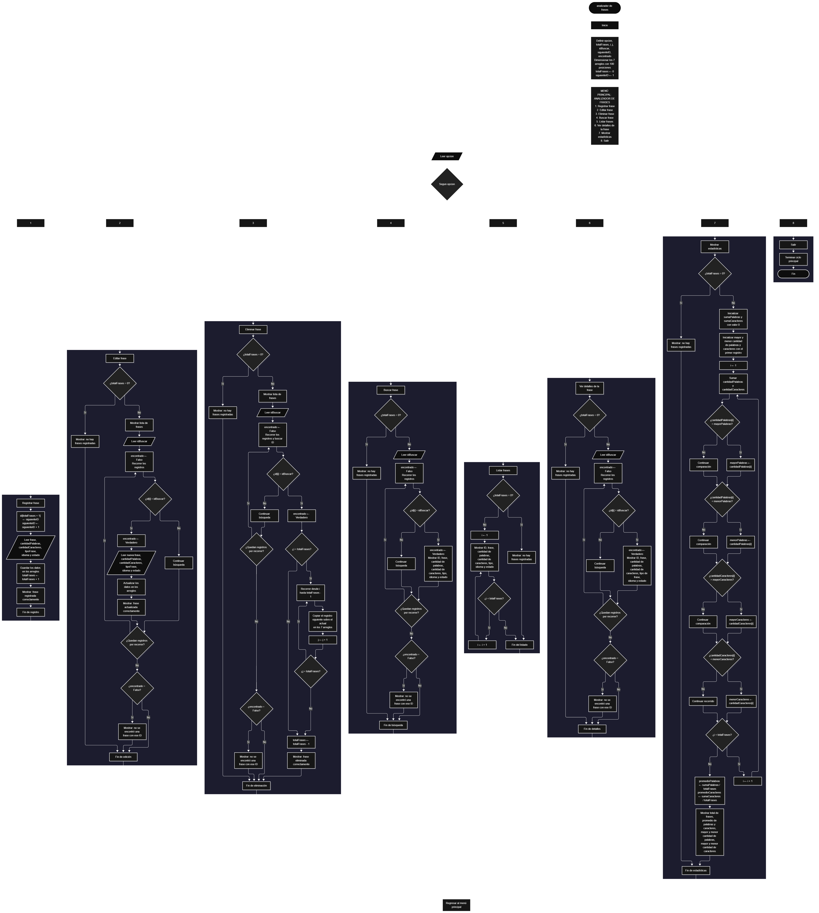

 

Este proyecto, llamado <b>analizador de frases</b>, fue desarrollado en <b>pseint</b> como un ejercicio práctico para fortalecer la lógica de programación mediante la creación de un sistema de gestión de frases desde la consola. El programa cuenta con un menú principal de ocho opciones que permite <b>registrar, editar, eliminar, buscar, listar y consultar los detalles de las frases registradas</b>, además de mostrar estadísticas generales. Cada frase almacena información como su identificador, contenido, cantidad de palabras, cantidad de caracteres, tipo de frase, idioma y estado. Para administrar estos datos, se utilizan siete arreglos con una capacidad definida de <b>100 posiciones cada uno</b>. Durante su desarrollo se aplicaron conceptos fundamentales de programación, como variables, arreglos, estructuras condicionales, ciclos repetitivos y estructuras de selección, además de procedimientos para buscar, modificar, eliminar y organizar registros. Este proyecto permite poner en práctica los conocimientos adquiridos en pseint y sirve como base para desarrollar sistemas de gestión más avanzados utilizando otros lenguajes y tecnologías.

<h2 align="center">⚙️ Funcionamiento del menú principal</h2>

### ➕ Registrar frase

La opción <b>1) registrar frase</b> permite almacenar una nueva frase junto con sus datos asociados. Para asignar un identificador, el programa utiliza la variable <b>siguienteID</b>, que comienza en <b>1</b> y aumenta en uno después de cada registro. El identificador y los datos se almacenan en la posición <b>totalFrases + 1</b> de sus respectivos arreglos. A continuación, el programa solicita la frase, la cantidad de palabras, la cantidad de caracteres, el tipo de frase, el idioma y el estado. Una vez ingresada toda la información, incrementa la variable <b>totalFrases</b> y muestra el mensaje <b>"frase registrada correctamente."</b>. Aunque los arreglos tienen una capacidad de 100 posiciones, el código actual no comprueba si se ha alcanzado ese límite antes de registrar una nueva frase.

### ✏️ Editar frase

La opción <b>2) editar frase</b> permite modificar los datos de una frase registrada mediante su identificador. Primero, el programa comprueba si existen frases almacenadas utilizando la variable <b>totalFrases</b>. Si no hay registros, muestra el mensaje <b>"no hay frases registradas."</b>. En caso contrario, presenta una lista con el identificador, la frase, la cantidad de palabras, la cantidad de caracteres, el tipo de frase, el idioma y el estado de cada registro. Después, solicita el ID de la frase que se desea editar e inicializa la variable lógica <b>encontrado</b> con el valor <b>Falso</b>. Mediante un ciclo <b>Para</b>, recorre los registros y compara los identificadores. Si encuentra una coincidencia, cambia <b>encontrado</b> a <b>Verdadero</b>, solicita los nuevos datos y actualiza los arreglos correspondientes. Finalmente, muestra el mensaje <b>"frase editada correctamente."</b>. Si no encuentra el identificador solicitado, presenta el mensaje <b>"no se encontró una frase con ese id."</b>.

### 🗑️ Eliminar frase

La opción <b>3) eliminar frase</b> permite eliminar una frase mediante su identificador. Antes de realizar la operación, el programa comprueba si existen registros. Si no hay frases almacenadas, muestra el mensaje <b>"no hay frases registradas."</b>. Si existen registros, presenta sus datos y solicita el ID de la frase que se desea eliminar. Después, inicializa la variable <b>encontrado</b> con el valor <b>Falso</b> y recorre los identificadores mediante un ciclo <b>Para</b>. Cuando encuentra una coincidencia, cambia la variable a <b>Verdadero</b>. Si la frase no ocupa la última posición, utiliza un ciclo <b>Para</b> controlado por la variable <b>j</b> para desplazar una posición hacia la izquierda los datos de los arreglos <b>id, frase, cantidadPalabras, cantidadCaracteres, tipoFrase, idioma y estado</b>. Posteriormente, disminuye <b>totalFrases</b> en uno y muestra el mensaje <b>"frase eliminada correctamente."</b>. Si no encuentra el ID solicitado, presenta el mensaje <b>"no se encontró una frase con ese id."</b>. El código no limpia expresamente la última posición después del desplazamiento, pero deja de considerarla activa al disminuir el total de frases.

### 🔎 Buscar frase

La opción <b>4) buscar frase</b> permite localizar una frase mediante su identificador. Primero, el programa comprueba si existen frases registradas. Si no hay registros, muestra el mensaje <b>"no hay frases registradas."</b>. En caso contrario, solicita el ID que se desea buscar e inicializa la variable lógica <b>encontrado</b> con el valor <b>Falso</b>. A continuación, utiliza un ciclo <b>Para</b> para recorrer los identificadores almacenados y compararlos con el valor introducido mediante la condición <b>id[i] = idBuscar</b>. Cuando encuentra una coincidencia, cambia <b>encontrado</b> a <b>Verdadero</b>, muestra el mensaje <b>"datos encontrados"</b> y presenta el identificador, la frase, la cantidad de palabras, la cantidad de caracteres, el tipo de frase, el idioma y el estado. Si finaliza el recorrido sin encontrar coincidencias, muestra el mensaje <b>"no se encontró una frase con ese id."</b>.

### 📋 Listar frases

La opción <b>5) listar frases</b> permite visualizar todos los registros activos. Antes de mostrar la información, el programa comprueba si <b>totalFrases</b> es igual a cero. Si no existen frases registradas, presenta el mensaje <b>"no hay frases registradas."</b>. Si existen registros, muestra el encabezado <b>"datos registrados"</b> y utiliza un ciclo <b>Para</b> para recorrer los arreglos desde la primera posición hasta el número total de frases almacenadas. Durante el recorrido, presenta el identificador, el contenido de la frase, la cantidad de palabras, la cantidad de caracteres, el tipo de frase, el idioma y el estado. Esta operación permite consultar los registros sin necesidad de buscar cada frase individualmente.

### 📄 Ver detalles de la frase

La opción <b>6) ver detalles de la frase</b> permite consultar individualmente todos los datos asociados a una frase específica. Primero, el programa comprueba si existen registros. Si no hay frases almacenadas, muestra el mensaje <b>"no hay frases registradas."</b>. En caso contrario, solicita el identificador de la frase e inicializa <b>encontrado</b> con el valor <b>Falso</b>. Después, recorre los registros mediante un ciclo <b>Para</b> y compara los identificadores. Cuando encuentra una coincidencia, cambia la variable a <b>Verdadero</b> y muestra por separado el ID, la frase, la cantidad de palabras, la cantidad de caracteres, el tipo de frase, el idioma y el estado. Si no encuentra el identificador solicitado, presenta el mensaje <b>"no se encontró una frase con ese id."</b>.

### 📊 Mostrar estadísticas

La opción <b>7) mostrar estadísticas</b> permite obtener un resumen numérico de las frases registradas. Primero, comprueba si existen registros; si no hay frases almacenadas, muestra el mensaje <b>"no hay frases registradas."</b>. Si existen datos, inicializa las variables <b>sumaPalabras</b> y <b>sumaCaracteres</b> en cero. También utiliza los valores de la primera frase para inicializar las variables que almacenan las cantidades mayores y menores de palabras y caracteres. Mediante un ciclo <b>Para</b>, recorre todos los registros activos, acumula las cantidades de palabras y caracteres, y actualiza los máximos y mínimos cuando encuentra valores superiores o inferiores. Al finalizar, calcula los promedios dividiendo las sumas correspondientes entre <b>totalFrases</b>. Finalmente, muestra el total de frases, el promedio de palabras, el promedio de caracteres, la mayor y menor cantidad de palabras y la mayor y menor cantidad de caracteres.

### 🚪 Salir del menú principal

La opción <b>8) salir</b> permite finalizar el ciclo del menú principal y muestra el mensaje <b>"gracias por utilizar el analizador de frases."</b>. El menú se encuentra dentro de una estructura repetitiva <b>Repetir ... Hasta Que</b>, cuya condición de salida es <b>opcion = 8</b>. Por lo tanto, cuando el usuario selecciona la opción 8, el programa muestra el mensaje de despedida y termina la repetición del menú.

<h2 align="center">🧠 Temas aplicados en el proyecto</h2>

### 📦 Variables

En este proyecto se utilizan variables para controlar la selección del menú, contar las frases registradas, asignar identificadores, recorrer los arreglos, localizar registros, acumular cantidades y calcular estadísticas. Cada variable cumple una función específica dentro de las operaciones del programa.

🔢 **Opcion:** Almacena la opción seleccionada por el usuario en el menú principal.

📊 **TotalFrases:** Almacena la cantidad actual de frases registradas.

🆔 **SiguienteID:** Genera identificadores consecutivos para las nuevas frases.

🔄 **I:** Controla los recorridos de los arreglos durante las operaciones de edición, eliminación, búsqueda, listado, consulta y estadísticas.

🔁 **J:** Controla el desplazamiento de los registros posteriores durante la eliminación de una frase.

🔎 **IdBuscar:** Almacena el identificador introducido por el usuario para localizar una frase.

✅ **Encontrado:** Variable lógica que indica si se encontró una frase con el ID solicitado.

🧮 **SumaPalabras y SumaCaracteres:** Acumulan las cantidades de palabras y caracteres para calcular los promedios.

📈 **MayorPalabras, MenorPalabras, MayorCaracteres y MenorCaracteres:** Almacenan los valores máximos y mínimos de palabras y caracteres.

📉 **PromedioPalabras y PromedioCaracteres:** Almacenan los promedios calculados a partir de los registros activos.

### 🗃️ Arreglos

El programa utiliza siete arreglos relacionados entre sí para almacenar los datos de las frases. Cada arreglo está dimensionado con <b>100 posiciones</b> y utiliza el mismo índice para representar los datos correspondientes a un mismo registro. Por ejemplo, la información de una frase situada en la posición <b>1</b> se encuentra distribuida entre <b>id[1], frase[1], cantidadPalabras[1], cantidadCaracteres[1], tipoFrase[1], idioma[1] y estado[1]</b>. Esta organización permite recorrer, buscar, modificar, mostrar y eliminar registros mediante una posición compartida.

🆔 **Id[100]:** Almacena los identificadores de las frases.

📝 **Frase[100]:** Almacena el contenido de cada frase.

🔢 **CantidadPalabras[100]:** Almacena la cantidad de palabras de cada frase.

🔠 **CantidadCaracteres[100]:** Almacena la cantidad de caracteres de cada frase.

🏷️ **TipoFrase[100]:** Almacena el tipo de frase indicado por el usuario.

🌐 **Idioma[100]:** Almacena el idioma indicado para cada frase.

📌 **Estado[100]:** Almacena el estado indicado para cada frase.

### 🔀 Estructuras condicionales

En este proyecto se utilizan las estructuras <b>Si</b> y <b>SiNo</b> para comprobar si existen frases registradas antes de ejecutar las operaciones, verificar si el ID introducido coincide con algún registro, determinar si una frase debe desplazarse durante la eliminación y actualizar los valores máximos y mínimos en las estadísticas. También se utiliza la variable lógica <b>encontrado</b> para distinguir entre una búsqueda exitosa y una búsqueda sin coincidencias. Estas condiciones permiten que el programa responda según la información almacenada y los resultados de cada operación.

### 🔄 Estructuras repetitivas

El programa utiliza los ciclos <b>Para</b> y <b>Repetir ... Hasta Que</b>. Los ciclos <b>Para</b> recorren los arreglos para mostrar, buscar, editar y consultar las frases, además de calcular las estadísticas. Durante la eliminación, otro ciclo <b>Para</b> desplaza los datos posteriores una posición hacia la izquierda para reorganizar los registros. Por su parte, <b>Repetir ... Hasta Que</b> mantiene activo el menú principal hasta que el usuario selecciona la opción 8.

### 🎯 Estructura según

El programa utiliza la estructura <b>Segun ... Hacer</b> para evaluar el valor de la variable <b>opcion</b> y ejecutar las instrucciones correspondientes. Cada caso representa una operación del menú: registrar, editar, eliminar, buscar, listar, ver detalles, mostrar estadísticas o salir. También incluye el bloque <b>De Otro Modo</b>, que muestra el mensaje <b>"opción no válida."</b> cuando el usuario introduce una opción que no coincide con los casos definidos.

### 🔢 Dimensionamiento de arreglos

La instrucción <b>Dimension</b> se utiliza para definir siete arreglos con una capacidad de <b>100 posiciones cada uno</b>. La variable <b>totalFrases</b> controla cuántos registros se consideran activos durante la ejecución. Aunque los arreglos tienen una capacidad definida, el código actual no incorpora una condición que impida registrar nuevas frases cuando se alcanza la posición 100.

### 🔄 Reorganización de registros

Cuando se elimina una frase que no ocupa la última posición, el programa utiliza la variable <b>j</b> para recorrer las posiciones desde el registro eliminado hasta <b>totalFrases - 1</b>. En cada repetición, copia los datos de la posición siguiente sobre la posición actual en los siete arreglos. Después, disminuye <b>totalFrases</b> en uno. Este procedimiento permite mantener consecutivas las posiciones de los registros activos. El código no borra explícitamente los valores de la última posición, pero esa posición deja de formar parte del conjunto de registros activos al reducirse el contador.

<h2 align="center">¿Cómo se implementaron las operaciones CRUD en el proyecto?</h2>

Las operaciones <b>CRUD</b> se implementaron mediante las opciones del menú principal para administrar las frases registradas. La operación <b>crear</b> corresponde a <b>registrar frase</b>, donde se almacenan una frase nueva y sus datos asociados. La operación <b>leer</b> se realiza mediante las opciones <b>buscar frase, listar frases y ver detalles de la frase</b>, que permiten consultar los registros. La operación <b>actualizar</b> corresponde a <b>editar frase</b>, donde se modifican los datos de una frase existente. Por último, la operación <b>eliminar</b> corresponde a <b>eliminar frase</b>, que desplaza los registros posteriores y disminuye el total de frases activas. Todas estas operaciones trabajan con arreglos en memoria durante la ejecución del programa; el código no incluye almacenamiento permanente en archivos o bases de datos.

<h2 align="center">Diagrama de flujo del proyecto</h2>

<h2 align="center">🛡️ Validaciones del programa</h2>

### 📭 No existen frases registradas

Esta comprobación se utiliza en las opciones de <b>editar, eliminar, buscar, listar, ver detalles y mostrar estadísticas</b>. El programa verifica si <b>totalFrases</b> es igual a <b>0</b>. Si no existen registros activos, muestra el mensaje <b>"no hay frases registradas."</b> y no continúa con la operación que requiere información almacenada.

### ❌ Frase no encontrada

Esta comprobación se utiliza en las operaciones de <b>editar, eliminar, buscar y ver detalles</b>. El programa inicializa la variable lógica <b>encontrado</b> con el valor <b>Falso</b> y recorre los identificadores almacenados. Cuando encuentra una coincidencia con <b>idBuscar</b>, cambia la variable a <b>Verdadero</b> y ejecuta la operación correspondiente. Si termina el recorrido y la variable permanece en <b>Falso</b>, muestra el mensaje <b>"no se encontró una frase con ese id."</b>.

### ⚠️ Capacidad de los arreglos

Los siete arreglos tienen una capacidad definida de <b>100 posiciones</b>. Sin embargo, la opción de registro no comprueba si <b>totalFrases</b> es menor que 100 antes de guardar los datos. Por esta razón, el código actual no cuenta con una validación explícita que impida superar la capacidad definida de los arreglos.

### 🔢 Cantidad de palabras y caracteres

Durante el registro y la edición, el programa solicita al usuario que introduzca la cantidad de palabras y la cantidad de caracteres de cada frase. Estos valores se almacenan directamente en los arreglos correspondientes. El código actual no calcula estas cantidades automáticamente a partir del texto ni comprueba que los números introducidos coincidan con el contenido de la frase.

### ⚠️ Opción no válida

La estructura <b>Segun</b> incluye el bloque <b>De Otro Modo</b>, que muestra el mensaje <b>"opción no válida."</b> cuando el usuario introduce un valor que no corresponde a ninguna de las opciones definidas en el menú principal. Esta respuesta permite informar al usuario que debe seleccionar una de las opciones disponibles.

<h2 align="center">🎯 Objetivo del proyecto</h2>

El objetivo principal de este proyecto es fortalecer la <b>lógica de programación</b> mediante el desarrollo de un sistema de gestión de frases en <b>pseint</b>. A través de su construcción se busca aplicar conocimientos sobre variables, arreglos, estructuras condicionales, ciclos repetitivos y estructuras de selección, integrándolos para resolver un problema de manera organizada. Además, el proyecto permite comprender cómo registrar, consultar, modificar y eliminar información, así como calcular estadísticas básicas a partir de los datos almacenados. De esta manera, constituye una base práctica para desarrollar sistemas de gestión más completos con otros lenguajes y tecnologías.

